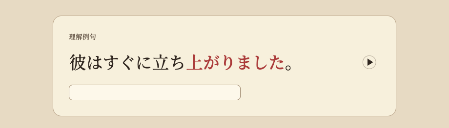
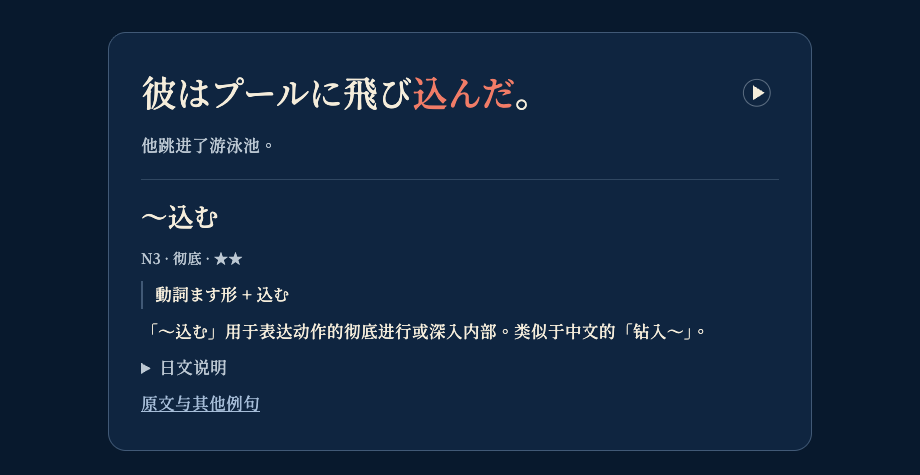

# おにぎり文法 · 和色版

从 [おにぎり文法](https://aiueo.cc/) 的例句出发，练听到或读到一句话时，能不能理解里面的构式。牌组沿用 N5–N1 的分级，每个语法点保留原站的例句、录音、中文译文和说明。

| 日间 · 理解题面 | 夜间 · 例句与说明 |
| --- | --- |
|  |  |

## 怎么学

正面读或听一句日文，回想整句意思。翻面先对照原句和译文，再看接续、文法说明与原站链接。可以用自己的中文措辞自评。常见构式理解一次就够的时候，可以只留一两句复习。有明显不同用法的例句则分别练，例如「飛び込む」和「読み込む」。

当前牌组用例句理解来学习语法。主动表达适合另做有明确交际意图的题，比如只给中文场景，让学习者自己用自然的日语表达。

## 卡面

白天用真朱，夜间用紺 × 珊瑚朱。配色、中文输入框开关都在 Anki 的「卡片模板 → 样式」。本机的 `Remark` 放在文法词条后面，按 E 可以直接编辑。

- [template.py](template.py) 管理五组例句的题面和背面。
- [style.css](style.css) 和 [palette.css](palette.css) 管理卡片样式与日夜配色。
- 每组例句使用日文、译文、音频三个字段，正反面共用同一份日文。

语法说明和例句归原作者，来源链接保留在卡片背面。字体采用 [源雲字体](https://github.com/ButTaiwan/genwan-font)，配色参考 [NIPPON COLORS](https://nipponcolors.com/)。
